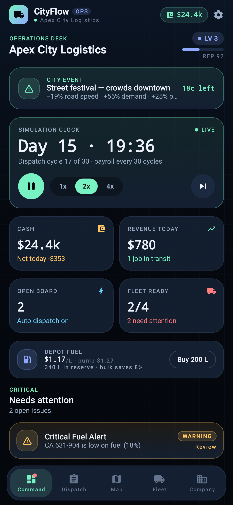
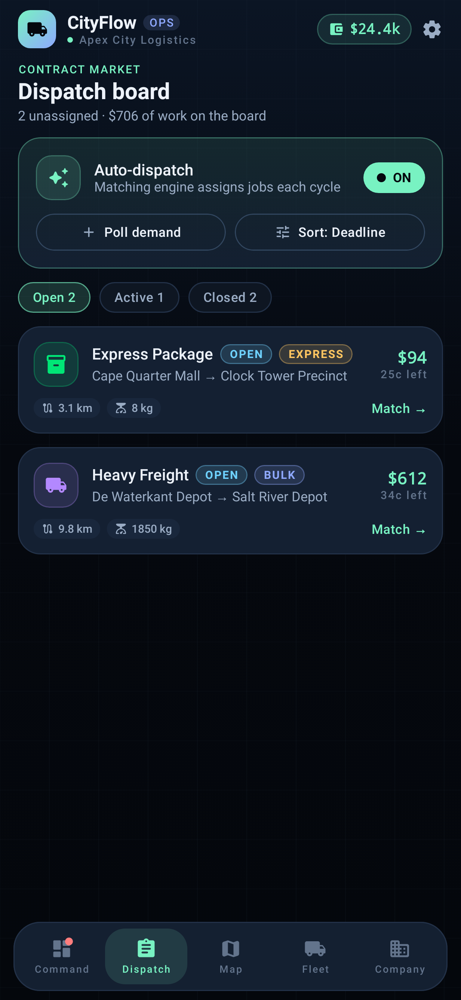
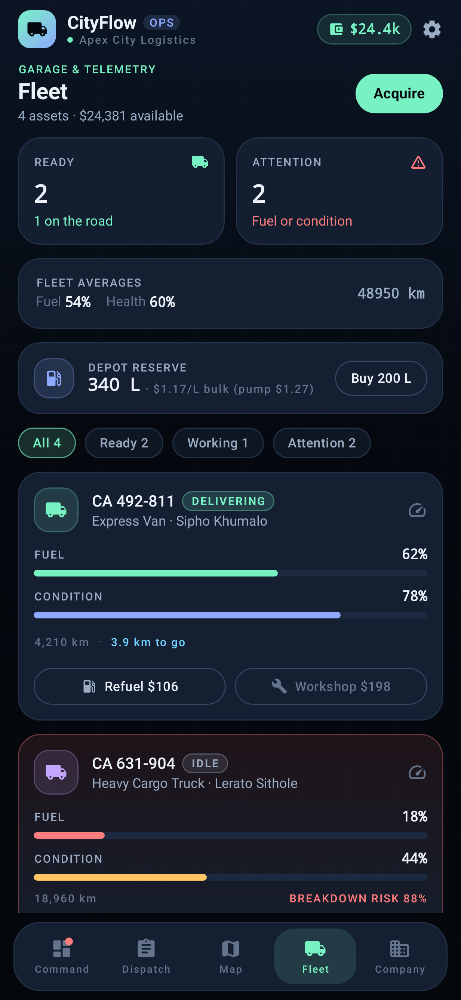
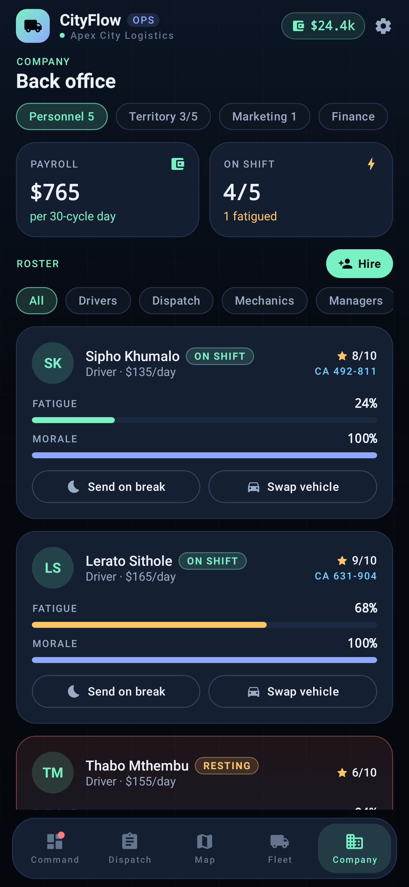
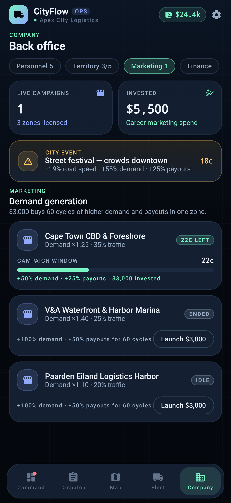
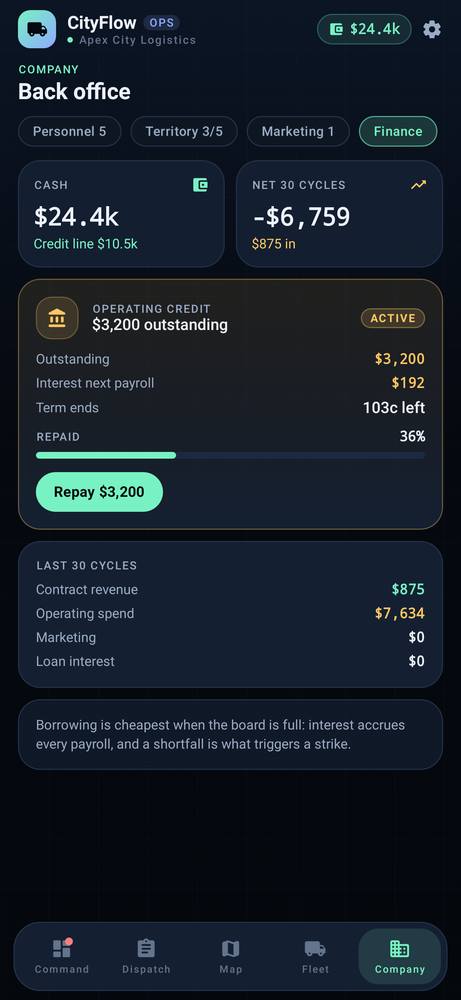

# CityFlow

City logistics management simulation for Android. The client renders server-owned state on a
MapLibre map and submits operator intents; a Kotlin Ktor service owns the simulation, PocketBase
stores the authoritative player state and realtime deltas, and OSRM supplies road geometry.

## Architecture

| Path | Purpose |
| --- | --- |
| `app/` | Android client: Compose console, MapLibre map, PocketBase auth/realtime/intents. |
| `app/.../ui/components/` | Shared design system: cards, stat tiles, meters, chips, empty states, formatters. |
| `app/.../ui/theme/` | Night-ops palette, type scale, shape scale, Material theme. |
| `server/` | Authoritative tick service: FSM, fuel, fatigue, incidents, payroll, demand, matching, Monte Carlo. |
| `backend/docker-compose.yml` | PocketBase 0.40.6 (built from the official release) + OSRM (MLD). |
| `backend/pocketbase/pb_migrations/` | v1 collections/rules, v2 progression fields, covering indexes and tightened intent rules. |
| `backend/seed/seed.mjs` | Creates the demo player. |
| `.github/workflows/` | `android-debug.yml` builds the APK; `server-tests.yml` runs simulation tests. |

The tick service is authoritative. The app never advances time or edits simulation state: it reads
PocketBase snapshots and SSE deltas, interpolates markers, and POSTs intents (assign, purchase,
refuel, hire, assign driver, shift, unlock, pause, speed, step, resolve, spawn). Every intent has an
idempotency key and is validated against the server's world before it is applied.

## Client console

The Android app is a five-destination operator console rather than a pile of tabs:

| Destination | Contents |
| --- | --- |
| **Command** | Sim clock with pause / 1x-2x-4x / step, cash and revenue tiles, fleet posture, open incidents, live dispatch board, recent ledger. |
| **Dispatch** | Contract market with open/active/closed filters, deadline/reward/newest sorting, and a match sheet that ranks idle vehicles with the same deterministic score the tick service uses. |
| **Map** | MapLibre live map, status filters, a horizontal fleet strip and a selected-asset card with fuel, condition and leg progress. |
| **Fleet** | Telemetry per asset, refuel and maintenance actions, breakdown-risk estimate, driver assignment and the dealer. |
| **Company** | Personnel roster (fatigue, morale, shifts, vehicle assignment, hiring), territory licensing with Monte Carlo projections, marketing campaigns, operating credit, and the full finance ledger. |

The design system lives in `ui/theme` and `ui/components`: a dark night-ops palette (mint for money
and primary action, iris for selection, amber/coral for attention), a monospaced numeric scale for
live readouts, a 20 dp card radius, and one component library shared by every screen. A level and
reputation badge surfaces the career counters that the tick service now persists.

| Command | Dispatch |
| --- | --- |
|  |  |

| Fleet | Ledger |
| --- | --- |
|  |  |

| Marketing | Finance |
| --- | --- |
|  |  |

These images are Robolectric renders of the real composables with fixture state
(`app/src/test/.../ConsoleScreenshotTest.kt`), not device captures — see Verification below.

## Operations systems

Six coupled systems sit on top of the tick loop. None of them is a standalone menu: each one changes
what the others are worth.

| System | What it adds | Where it shows |
| --- | --- | --- |
| **Freight tiers** | Every board entry is standard, express or bulk. Express pays ×1.7 for a 65% deadline; bulk is heavy cargo with more slack and ×1.3. Auto-dispatch works express first. | Dispatch badges, reward/deadline on every card |
| **Workshop & condition** | Condition wears per km; roadworks accelerate it. Booking a bay costs $198 and ties the asset up for 2–7 cycles depending on mechanic skill, then restores it to 100%. | Fleet cards, `MAINTENANCE` countdown |
| **Fuel market** | The pump price drifts every 20 cycles. A depot reserve bought in bulk is 8% cheaper and is consumed before pump fuel on every refuel. | Depot cards on Command and Fleet |
| **Marketing** | $3,000 buys 60 cycles of +100% demand and +50% payouts in one zone. One campaign per zone at a time. | Company → Marketing |
| **Operating credit** | Credit line is $3,000 + $150 per completed job (cap $25,000). Draw against it, 6% interest each payroll, principal auto-repays while a cash buffer remains. | Company → Finance |
| **City events** | Every 120 cycles a 60-cycle event starts: rain, festival, union action, heatwave or roadworks. Each scales road speed, demand, payouts, and roadworks add wear. | Command and Marketing banners |

**How it flows:** events and campaigns raise demand → express work pays a premium but compresses the
deadline → longer or faster legs burn fuel and condition → the depot price and workshop bill decide
whether the premium survives → every delivery grows the credit line → credit covers a payroll gap but
books interest into the ledger. A runaway campaign in a low-capacity fleet simply creates expired
contracts and reputation loss, which is the intended trap.

Campaigns persist in their own owner-scoped `campaigns` collection; fuel price/reserve, the active
loan and the active event live on the `players` record so a client restart shows the same market.

## Quick start

### 1. Backend

```bash
mkdir -p backend/osrm/data
curl -L -o backend/osrm/data/south-africa-latest.osm.pbf \
  https://download.geofabrik.de/africa/south-africa-latest.osm.pbf
cd backend && docker compose up -d --build
```

OSRM extraction happens once in the `osrm-prepare` container; the routed service then listens on
`http://localhost:5000`. Create an admin and the demo player:

```bash
docker compose exec pocketbase /pb/pocketbase superuser upsert admin@example.com 'change-me-now'
PB_ADMIN_EMAIL=admin@example.com PB_ADMIN_PASSWORD='change-me-now' node seed/seed.mjs
```

PocketBase runs at `http://localhost:8090` with the migrations mounted from
`backend/pocketbase/pb_migrations`. Fresh databases apply them automatically.

### 2. Tick service

```bash
cd server
SIM_MODE=pocketbase \
POCKETBASE_URL=http://localhost:8090 \
PB_ADMIN_EMAIL=admin@example.com \
PB_ADMIN_PASSWORD='change-me-now' \
OSRM_URL=http://localhost:5000 \
PORT=8080 gradle run
```

The service authenticates as superuser, seeds a newly registered player's fleet, advances one tick
per `TICK_INTERVAL_MS` (default 2000 ms; 1 tick = 1 simulated minute), writes all collections, and
consumes pending intents. `SIM_MODE=local` runs one in-memory world without PocketBase.

Health: `GET /health`, snapshot: `GET /api/state/{playerId}`, projection:
`POST /api/expansion/simulate`.

### 3. Android

The client defaults to the emulator host `http://10.0.2.2:8090` for PocketBase and
`http://10.0.2.2:5000` for OSRM, and signs in / registers the demo player
`demo@cityflow.local` / `cityflow123` automatically. On a physical device, open **Settings** in the
app and set the PocketBase and OSRM URLs to the machine running the backend.

```bash
echo "sdk.dir=$HOME/android-sdk" > local.properties
./gradlew :app:assembleDebug
adb install -r app/build/outputs/apk/debug/app-debug.apk
```

Cleartext HTTP is enabled for local development. Map tiles come from OpenStreetMap and the map shows
`© OpenStreetMap contributors`.

## Simulation rules

- **Movement**: one tick = one minute. Vehicles move along the OSRM polyline; no straight-line
  fallback. Routes come from `GET /route/v1/driving/{lng},{lat};...`.
- **Fuel**: `base × (1 + payload_kg × 0.0005) × (1 + traffic × 0.1) / skill`. Below 15% opens a
  severity-2 alert; three ignored ticks break the vehicle down (tow cost + severity-3 incident).
  Condition below 20% breaks down immediately.
- **Fatigue**: driving adds 0.45/tick, idle 0.15/tick. Above 80 the driver is forced to rest, the
  vehicle is released and the contract reopens.
- **Payroll**: every 30 ticks. An unpayable payroll clamps cash at zero, cuts morale and starts a
  strike.
- **Matching**: pure, order-independent; weighted proximity/ETA/suitability/skill/fuel minus fatigue
  and congestion, threshold 0.35, tie-break lowest driver id then vehicle id. Cargo above 500 kg
  needs a truck; chilled food needs the refrigerated van; sedans cannot carry cargo.
- **Demand**: seeded per-zone Poisson processes over Cape Town POIs. Zone demand is multiplied by
  the active city event and by any campaign running in that zone. No randomness outside the seeded
  demand stream.
- **Tiers**: 32% of generated work is express (×1.7 reward, 65% of the normal deadline) and 18% of
  cargo is bulk (×1.3 reward, 115% deadline). Reward and expiry are fixed at generation time, so a
  tier never silently changes after assignment.
- **Fuel market**: `fuel_price` drifts ±6% every 20 cycles, clamped to 0.90–1.60. Depot fuel costs
  `litres × price × 0.92` and fills up to 800 L; `REFUEL` draws the reserve first and only charges the
  pump for the remainder (plus the $25 call-out when any pump fuel is needed).
- **Workshop**: `SCHEDULE_SERVICE` only accepts idle vehicles. Bay time is `7 − mechanicSkill/4`,
  clamped to 2–7 cycles; the vehicle returns at 100% condition. Condition wear is `km × class wear`,
  ×1.6 during roadworks.
- **Credit**: one operating loan at a time, drawn up to the credit line. Interest is booked every
  payroll (`remaining × 6%`), then up to the cash above a $1,500 buffer is applied to principal.
  Missing payroll still triggers the strike path regardless of the loan.
- **Events**: a deterministic event roll every 120 cycles (`Rng.seed(seed, tick, "city-event")`)
  starts a 60-cycle modifier. `advanceCity()` owns event expiry, pump-price drift and campaign
  countdowns, so all three stay replayable from the seed.
- **History**: active + last 200 closed contracts, last 40 resolved incidents and 400 ledger rows are
  retained to bound sync cost. Lifetime delivered/missed counts and revenue are carried separately
  so progression survives that window.
- **Rostering**: a driver holds one vehicle and a vehicle holds one driver. `ASSIGN_DRIVER` moves both
  sides atomically, rejects moving assets, and only accepts drivers on shift. Hiring charges a $350
  placement fee and an unpayable payroll still triggers the strike path.
- **Progression**: the tick service derives level, XP, reputation, lifetime revenue and distance on
  save, so the client can show a career record without recomputing the ledger.

## Verification

Run in this workspace (JDK 21, Gradle 9.3.1, Android SDK 36.1):

- `gradle -p server test` — **17 tests, 0 failures**: polyline adherence, order-independent matching,
  suitability rejection, low-fuel breakdown + tow, payroll clamp/strike, duplicate intent rejection,
  deterministic Monte Carlo, driver assignment (including rejection of moving assets), recruitment
  fee, lifetime counters surviving the windowed contract list, tier pricing and generated tiers,
  discounted depot fuel drawn before pump fuel, campaign demand lift, credit-line enforcement +
  interest, workshop countdown, and scheduled city events slowing a leg.
- `gradle :app:assembleDebug :app:testDebugUnitTest` — debug APK builds; **14 unit tests pass**
  (3 JVM + 1 Robolectric example + 10 console tests).
- `ConsoleScreenshotTest` renders the console with fixture state under Robolectric native graphics and
  writes PNGs to `app/build/screenshots/` for Command, Dispatch, Fleet and Company (Personnel,
  Territory, Marketing, Finance, Ledger), plus two wiring tests (navigation between destinations and
  the clock control). These renders were reviewed visually and drove the layout fixes in this change
  (card widths, overlapping roster controls, ambiguous zone icons, dead sort control, an event banner
  that wrapped its effect line onto a second row).
- **Live stack:** PocketBase 0.40.6 (real binary, not Docker) had all three migrations applied and the
  schema inspected directly — progression fields, fuel/credit/event/loan fields, `service_ticks` on
  vehicles, `tier` on contracts, the owner-scoped `campaigns` collection with both indexes, and the
  five covering indexes plus insert-only `intents` rules. The tick service then ran against it with a
  mock OSRM:
  - A brand-new player seeded its fleet, kept `auto_dispatch` on, assigned work and completed
    contracts within 29 ticks.
  - The board generated real tiers (`standard 23 / express 9 / bulk 2` in the observed sample) and
    express work was dispatched first.
  - `BUY_FUEL`, `START_CAMPAIGN`, `TAKE_LOAN` and `SCHEDULE_SERVICE` all completed as `done` intents:
    the depot held 200 L, the CBD campaign spent $3,000 and expired after its 60 cycles, a $4,350 loan
    was drawn (then auto-settled from the cash buffer), and the workshop returned `veh_02` to 100%
    condition and `idle`.
  - Lifetime counters persisted (`contracts_completed`, `contracts_failed`, `total_revenue`,
    `distance_km`, `xp`, `level`, `reputation`) while fleet mileage and route geometry updated.
  - `HIRE_STAFF` round-tripped through the intent queue, wrote the $350 placement fee to the ledger,
    and `ASSIGN_DRIVER` bound the new driver to `veh_02` in PocketBase.

This live run also caught and fixed two real defects: `toWorld` threw on a fresh player's null
`base_location` (so the initial fleet was never seeded), and a new player persisted
`auto_dispatch = false` (so the matching engine never ran and contracts only expired).

Not verified in this environment:

- On-device/emulator interaction. MapLibre cannot render under Robolectric, so the Map destination
  (style, tiles, marker taps, overlay placement) is reviewed by code only.
- Real OSRM routing against the South Africa PBF (a deterministic mock supplied geometry), and
  GitHub Actions execution.
- Event banners in a live app session: the tick service spawned events on schedule at cycle 120 and
  they expired at 180, which the run had already passed by the time it was inspected. The spawn,
  modifier and expiry logic are covered by the server test and the screenshot fixture instead.

## Security notes

- No superuser credentials exist in the APK. The client uses the ordinary demo player account and
  owner-scoped PocketBase rules (`owner = @request.auth.id`).
- The server needs superuser credentials at runtime; pass them as environment variables, never commit
  them.
- `users`/`_superusers` are untouched; player records are the auth collection used by the game.
- Intents are insert-only for players: schema v2 restricts updates and deletes on `intents` to the
  superuser, so the tick service is the only writer of their outcome.
- Campaigns are owner-scoped like every other collection (`owner = @request.auth.id`), and the
  credit/loan and event state live on the player record, so a client cannot grant itself credit or
  manufacture a campaign payout.
- Cleartext traffic is for local development only; use HTTPS and a reverse proxy for a hosted
  deployment.
